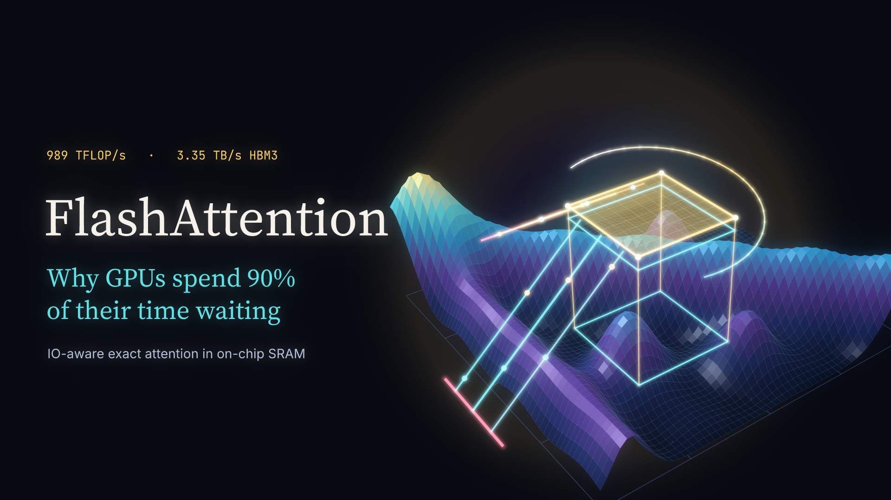

# FlashAttention: Why GPUs Spend 90% of Their Time Waiting



**Goal:** Inside the GPU memory wall: H100 roofline arithmetic intensity, 3D SRAM attention tiling, and exact online softmax rescaling that cuts HBM traffic by an order of magnitude.

- **Watch online:** https://bvolpato.github.io/vizmatic-public-videos/flash-attention/
- **Category:** AI & ML
- **Format:** 1920x1080 @ 30 fps (~2:37)

## Scenes

1. **Why GPUs spend 90% of their time waiting** (`scenes/hook.ts`)
2. **The GPU memory hierarchy and Roofline wall** (`scenes/memorywall.ts`)
3. **Tiling the attention landscape inside SRAM** (`scenes/tiling.ts`)
4. **Exact online softmax without seeing the full row** (`scenes/onlinesoftmax.ts`)
5. **Don't write what you can fuse** (`scenes/finale.ts`)

## Build & Check

```sh
uv run factory/build.py flash-attention --check-only
uv run factory/build.py flash-attention
```
