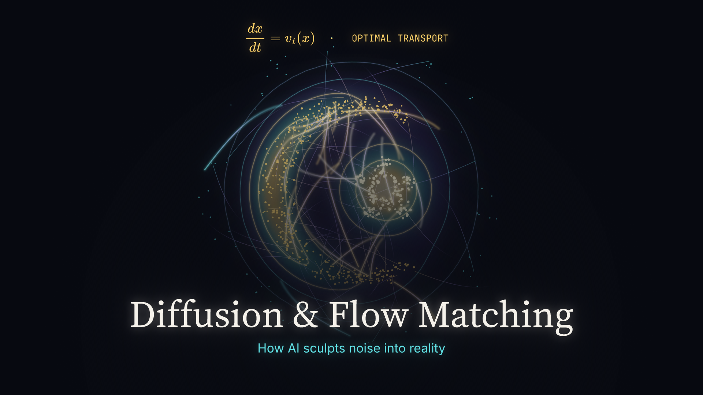

# Diffusion & Flow Matching: How AI Sculpts Noise Into Reality



**Goal:** Watch chaotic Gaussian noise snap into structure along optimal-transport streamlines, race 50-step curved diffusion against 4-step straight flow matching, and orbit a morphing 3D probability density manifold.

- **Watch online:** https://bvolpato.github.io/vizmatic-public-videos/flow-matching/
- **Category:** AI & ML
- **Format:** 1920x1080 @ 30 fps (~2:25)

## Scenes

1. **Sculpting noise into reality** (`scenes/hook.ts`)
2. **Learning the velocity vector field** (`scenes/noisefield.ts`)
3. **Curved diffusion versus straight flow matching** (`scenes/curvedvsstraight.ts`)
4. **The evolving 3D probability density manifold** (`scenes/density3d.ts`)
5. **Straight paths turn a thousand steps into a blink** (`scenes/finale.ts`)

## Build & Check

```sh
uv run factory/build.py flow-matching --check-only
uv run factory/build.py flow-matching
```
