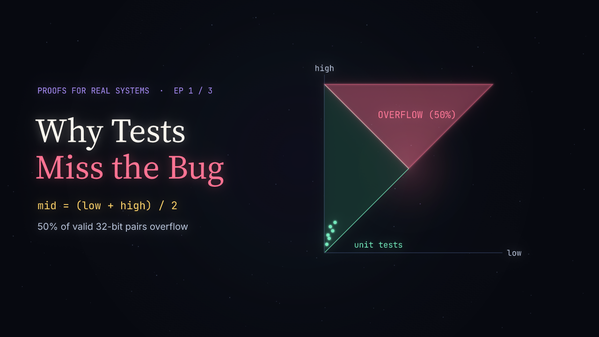

# Why Tests Miss the Bug



**Goal:** Episode 1 of Proofs for Real Systems: why unit tests sample corners of an exponential input space, how SMT solvers, TLA+, and Lean 4 cover what tests miss, and why proofs matter even more for AI-written code.

- **Watch online:** https://bvolpato.github.io/vizmatic-public-videos/formal-verification/01-why-prove/
- **Category:** Formal Verification · Proofs for Real Systems (1/3)
- **Format:** 1920x1080 @ 30 fps (~1:05)

## Scenes

1. **Half the plane was broken** (`scenes/hook.ts`)
2. **Tests sample; formal methods cover** (`scenes/spectrum.ts`)
3. **When AI writes the code** (`scenes/ai.ts`)

## Build & Check

```sh
uv run factory/build.py formal-verification/01-why-prove --check-only
uv run factory/build.py formal-verification/01-why-prove
```
