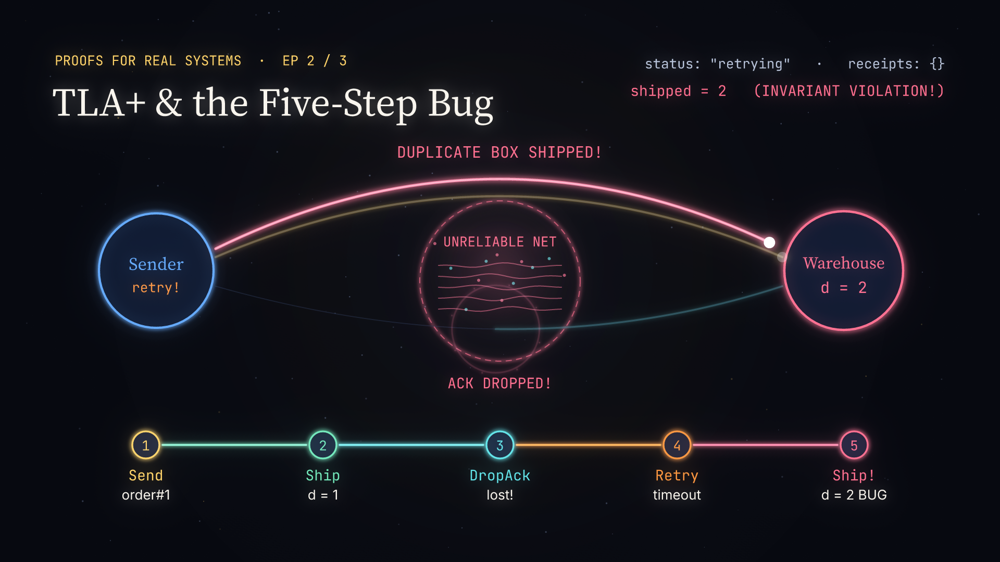

# TLA+ & the Five-Step Bug



**Goal:** Episode 2 of Proofs for Real Systems: model an order retry protocol in TLA+, watch TLC uncover a 5-step duplicate-shipment counterexample, repair it with an atomic receipt, and compare weak vs strong fairness.

- **Watch online:** https://bvolpato.github.io/vizmatic-public-videos/formal-verification/02-tla-plus/
- **Category:** Formal Verification · Proofs for Real Systems (2/3)
- **Format:** 1920x1080 @ 30 fps (~1:10)

## Scenes

1. **Where did the reply go?** (`scenes/protocol.ts`)
2. **TLC explores every reachable state** (`scenes/graph.ts`)
3. **Safety vs liveness and fairness** (`scenes/fairness.ts`)

## Build & Check

```sh
uv run factory/build.py formal-verification/02-tla-plus --check-only
uv run factory/build.py formal-verification/02-tla-plus
```
