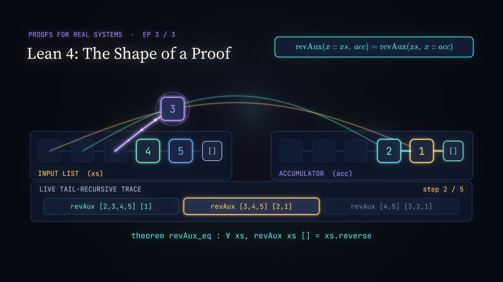

# Lean 4: Inside a Machine-Checked Proof



**Goal:** Episode 3 of Proofs for Real Systems: follow tail-recursive list reversal from a failed induction to a generalized accumulator proof, and see how Lean 4's tiny trusted kernel checks every proof term.

- **Watch online:** https://bvolpato.github.io/vizmatic-public-videos/formal-verification/03-lean4/
- **Category:** Formal Verification · Proofs for Real Systems (3/3)
- **Format:** 1920x1080 @ 30 fps (~1:01)

## Scenes

1. **One list, then every finite list** (`scenes/tiles.ts`)
2. **Generalizing the accumulator** (`scenes/induction.ts`)
3. **Inside Lean's tiny trusted kernel** (`scenes/kernel.ts`)

## Build & Check

```sh
uv run factory/build.py formal-verification/03-lean4 --check-only
uv run factory/build.py formal-verification/03-lean4
```
