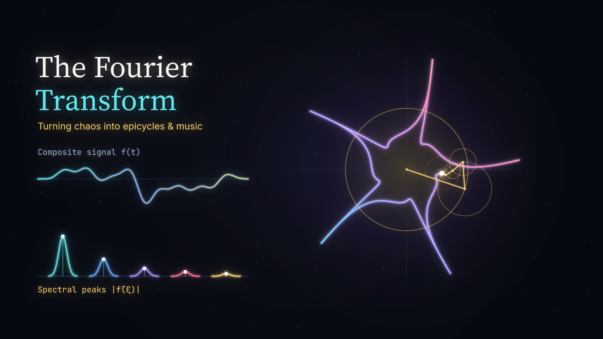

# The Fourier Transform: Turning Chaos Into Epicycles & Music



**Goal:** A cinematic 2:20 visual journey into the Fourier Transform: exploding waveforms, the complex winding machine, exact DFT epicycles, an orbiting 3D time-frequency spectrogram, and Parseval's energy law.

- **Watch online:** https://bvolpato.github.io/vizmatic-public-videos/fourier-transform/
- **Category:** Mathematics
- **Format:** 1920x1080 @ 30 fps (~2:32)

## Scenes

1. **Splitting chaos into spinning circles** (`scenes/hook.ts`)
2. **The complex winding machine** (`scenes/winding.ts`)
3. **Exact DFT epicycles** (`scenes/epicycles.ts`)
4. **The 3D time-frequency landscape** (`scenes/spectrum3d.ts`)
5. **A choir of spinning circles** (`scenes/finale.ts`)

## Build & Check

```sh
uv run factory/build.py fourier-transform --check-only
uv run factory/build.py fourier-transform
```
