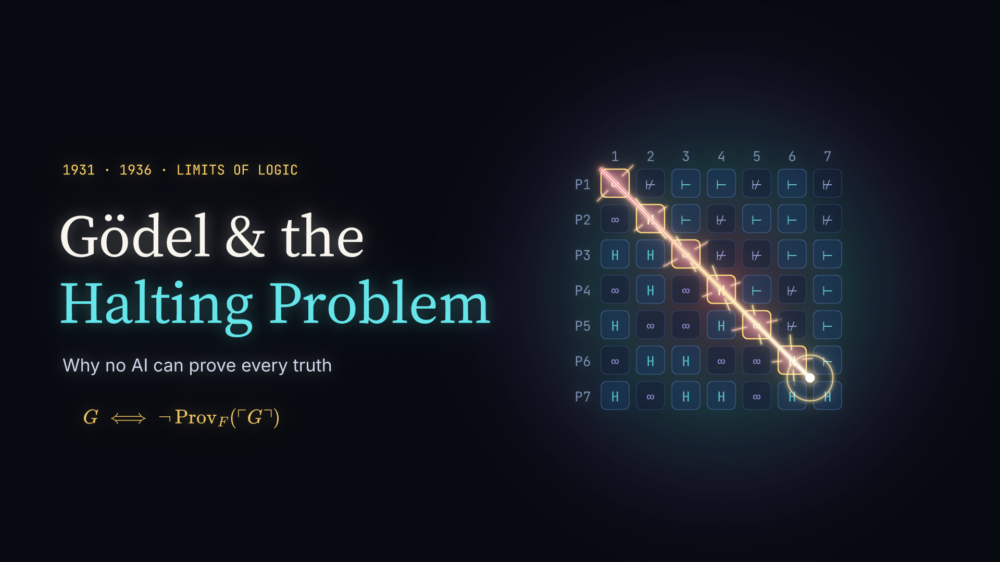

# Gödel & the Halting Problem: Why No AI Can Prove Every Truth



**Goal:** A 2:20 visual journey through the deepest limit of mathematics and computation: prime-power Gödel numbering, Turing's diagonal paradox shockwave, and an orbiting 3D horizon of unprovable truths.

- **Watch online:** https://bvolpato.github.io/vizmatic-public-videos/godel-halting/
- **Category:** Mathematics
- **Format:** 1920x1080 @ 30 fps (~2:31)

## Scenes

1. **A blind spot baked into logic** (`scenes/hook.ts`)
2. **Gödel's prime-power mirror** (`scenes/godelnumber.ts`)
3. **Turing's 1936 halting contradiction** (`scenes/diagonal.ts`)
4. **The expanding horizon of truth** (`scenes/horizon3d.ts`)
5. **Truth is always larger than proof** (`scenes/finale.ts`)

## Build & Check

```sh
uv run factory/build.py godel-halting --check-only
uv run factory/build.py godel-halting
```
