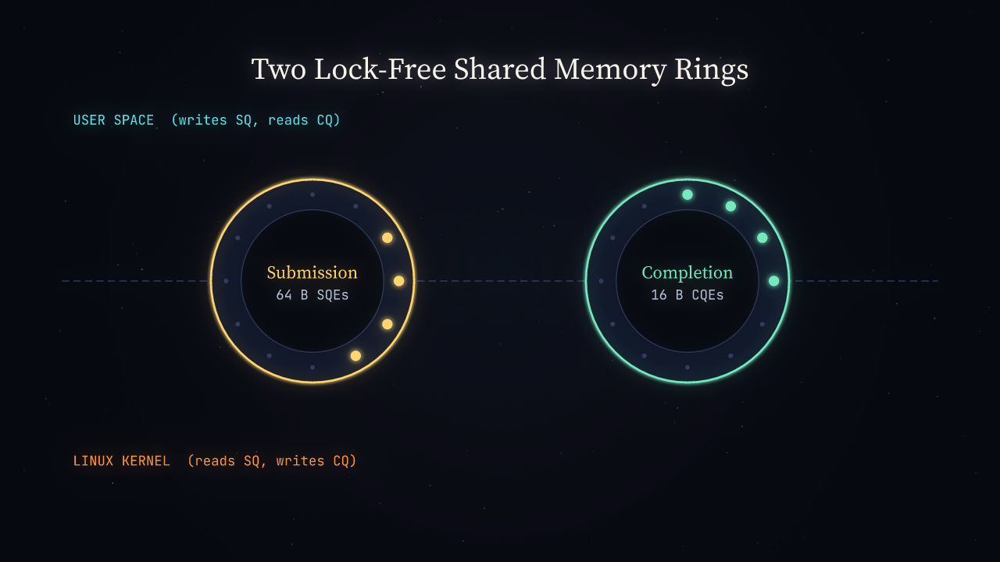

# io_uring: Inside Linux's Zero-Syscall I/O Engine



**Goal:** Follow one 4 KiB read across the user/kernel boundary, through io_uring's twin shared ring buffers, SQPOLL zero-syscall batching, and below the rings into the page cache versus O_DIRECT on NVMe.

- **Watch online:** https://bvolpato.github.io/vizmatic-public-videos/io-uring/
- **Category:** Linux & Storage
- **Format:** 1920x1080 @ 30 fps (~2:13)

## Scenes

1. **Crossing the kernel wall** (`scenes/hook.ts`)
2. **Two shared rings in memory** (`scenes/rings.ts`)
3. **From thirty-two crossings to one, to zero** (`scenes/batching.ts`)
4. **Below the rings: page cache vs direct I/O** (`scenes/storage.ts`)
5. **Power, policy, and shared memory** (`scenes/finale.ts`)

## Build & Check

```sh
uv run factory/build.py io-uring --check-only
uv run factory/build.py io-uring
```
