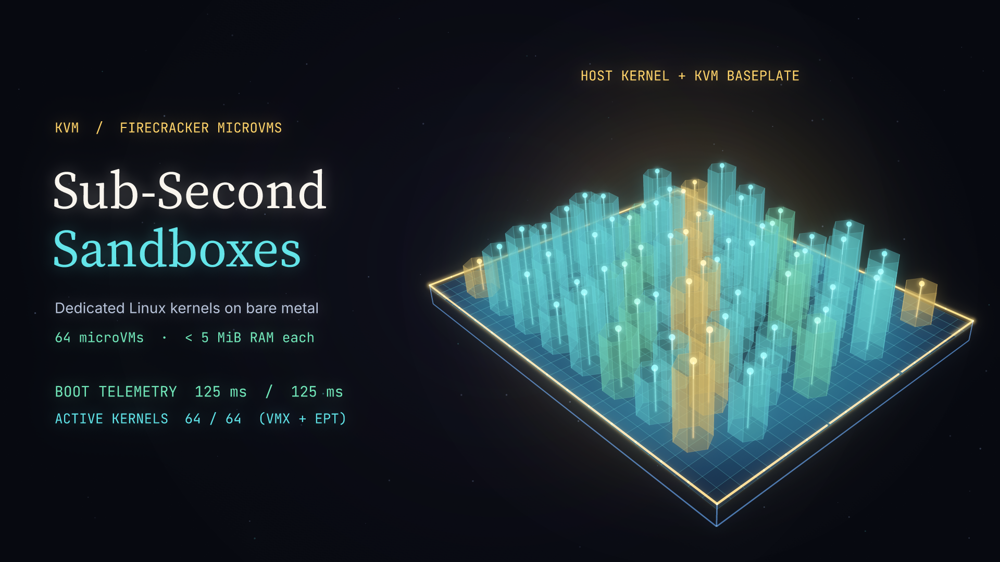

# MicroVMs & KVM: From One CPU Instruction to Sub-Second Sandboxes



**Goal:** How Linux KVM hardware virtualization and AWS Firecracker combine to isolate untrusted code in milliseconds — from VM exits and EPT to minimal Rust VMMs, seccomp jails, and snapshot clones.

- **Watch online:** https://bvolpato.github.io/vizmatic-public-videos/linux-microvms/
- **Category:** Linux & Virtualization
- **Format:** 1920x1080 @ 30 fps (~2:43)

## Scenes

1. **Isolating untrusted code in milliseconds** (`scenes/hook.ts`)
2. **One CPU instruction out through KVM and back** (`scenes/kvm.ts`)
3. **Stripping the monitor to bare essentials** (`scenes/firecracker.ts`)
4. **Snapshots, lazy memory, and the clone trap** (`scenes/snapshots.ts`)
5. **Hardware isolation at container speed** (`scenes/finale.ts`)

## Build & Check

```sh
uv run factory/build.py linux-microvms --check-only
uv run factory/build.py linux-microvms
```
