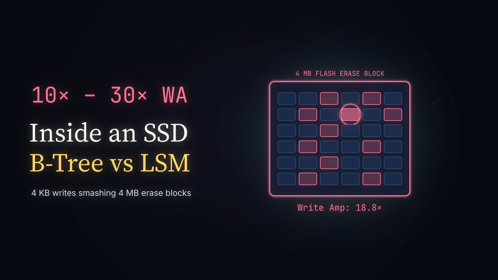

# Inside an SSD: B-Trees vs LSM-Trees and the Write-Amplification Wall



**Goal:** A cinematic dive into NVMe flash silicon: 4 KB pages inside 4 MB erase blocks, B-Tree random write amplification, an orbiting 3D leveled LSM-tree pyramid with Bloom filter laser gates, and the RUM tradeoff.

- **Watch online:** https://bvolpato.github.io/vizmatic-public-videos/lsm-vs-btree/
- **Category:** Linux & Storage
- **Format:** 1920x1080 @ 30 fps (~2:13)

## Scenes

1. **The write-amplification wall** (`scenes/hook.ts`)
2. **Pages, erase blocks, and FTL storms** (`scenes/flashphysics.ts`)
3. **B-Tree in-place leaf mutations** (`scenes/btreewall.ts`)
4. **The 3D leveled LSM-tree pyramid** (`scenes/lsm3d.ts`)
5. **The RUM tradeoff in balance** (`scenes/finale.ts`)

## Build & Check

```sh
uv run factory/build.py lsm-vs-btree --check-only
uv run factory/build.py lsm-vs-btree
```
