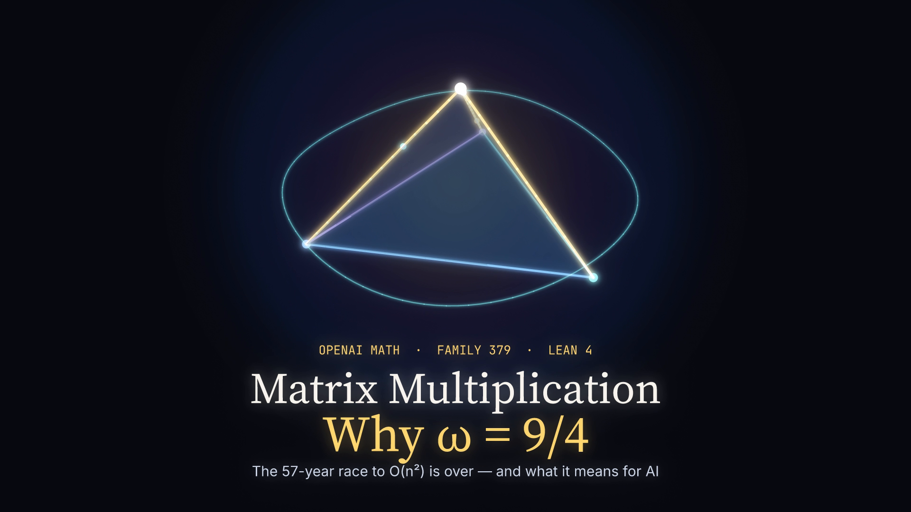

# Matrix Multiplication: Why ω = 9/4 Changes Computing



**Goal:** A cinematic breakdown of the Lean 4 proof pinning matrix multiplication at ω = 9/4: live crossing-wire Strassen, Border Rank & Laser blocks, polynomial degenerations, CAT(0) tripod geometry, the α = 1/2 rectangular law, and what it changes for AI.

- **Watch online:** https://bvolpato.github.io/vizmatic-public-videos/matrix-exponent/
- **Category:** Mathematics
- **Format:** 1920x1080 @ 30 fps (~3:22)

## Scenes

1. **The 57-Year Dream Just Hit a Wall** (`scenes/hook.ts`)
2. **How the Algorithms Evolved to 9/4** (`scenes/race.ts`)
3. **Why 9/4? The Curved Tensor Tripod** (`scenes/geometry.ts`)
4. **Rectangular Law & What Changes for AI** (`scenes/ai.ts`)
5. **A 57-Year Limit, Formalized** (`scenes/finale.ts`)

## Build & Check

```sh
uv run factory/build.py matrix-exponent --check-only
uv run factory/build.py matrix-exponent
```
