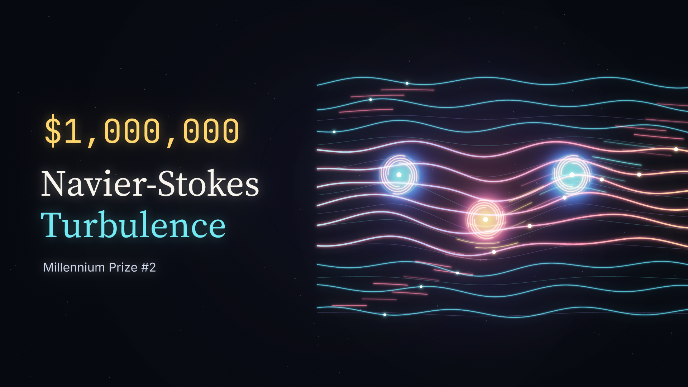

# The Navier-Stokes $1,000,000 Problem: Why Turbulence Breaks Math



**Goal:** Millennium Prize #2: A cinematic 2:20 visual journey through the Navier-Stokes existence and smoothness problem — Kelvin-Helmholtz vortices, Reynolds transition, Biot-Savart advection, 3D vortex stretching, and Kolmogorov's turbulent cascade.

- **Watch online:** https://bvolpato.github.io/vizmatic-public-videos/navier-stokes/
- **Category:** Mathematics · Millennium Prize #2
- **Format:** 1920x1080 @ 30 fps (~2:30)

## Scenes

1. **The million-dollar turbulence mystery** (`scenes/hook.ts`)
2. **Newton's law for fluids** (`scenes/equation.ts`)
3. **2D spirals versus 3D vortex stretching** (`scenes/vortices.ts`)
4. **Kolmogorov's cascade and finite-time blow-up** (`scenes/cascade3d.ts`)
5. **Smooth forever or infinite velocity** (`scenes/finale.ts`)

## Build & Check

```sh
uv run factory/build.py navier-stokes --check-only
uv run factory/build.py navier-stokes
```
