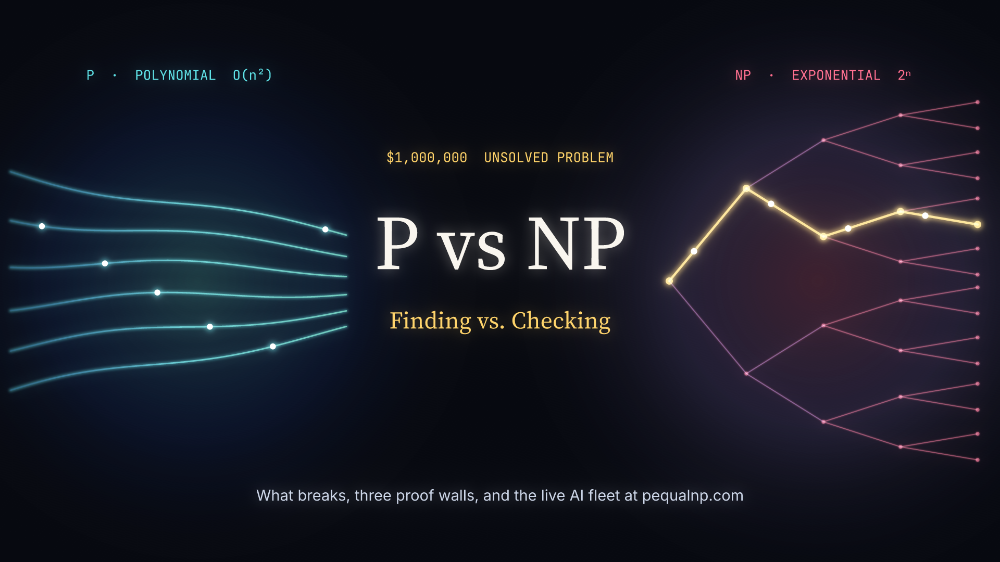

# P vs NP: The $1,000,000 Problem & the Live AI Proof Fleet



**Goal:** A cinematic breakdown of P vs NP, what breaks if P = NP vs P ≠ NP, the three proof walls explained with everyday analogies, and the live AI fleet attacking it in Lean 4 at pequalnp.com.

- **Watch online:** https://bvolpato.github.io/vizmatic-public-videos/p-vs-np/
- **Category:** Mathematics · Millennium Prize #3
- **Format:** 1920x1080 @ 60 fps (~2:43)

## Scenes

1. **P vs NP: Finding vs. Checking at Universe Scale** (`scenes/hook.ts`)
2. **Two Universes: P = NP vs. P ≠ NP** (`scenes/worlds.ts`)
3. **Three Hidden Walls Explained Simply** (`scenes/barriers.ts`)
4. **Inside pequalnp.com: Live AI Fleet & Real Progress** (`scenes/pequalnp.ts`)
5. **One Million Dollars, One Strict Judge** (`scenes/finale.ts`)

## Build & Check

```sh
uv run factory/build.py p-vs-np --check-only
uv run factory/build.py p-vs-np
```
