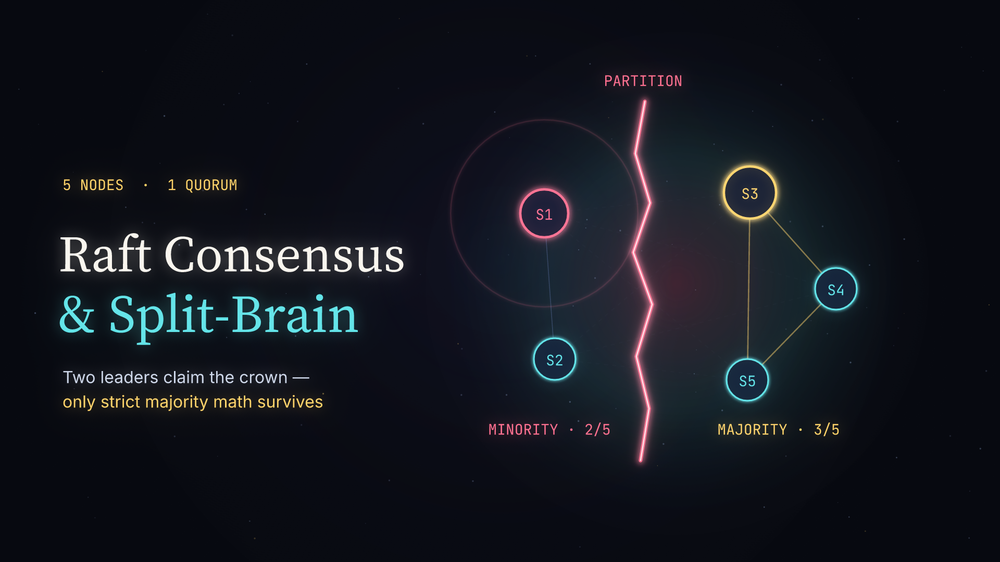

# Raft Consensus & Split-Brain: Why Distributed Systems Survive Partitions



**Goal:** A cinematic visual breakdown of Raft consensus: leader heartbeats sliced by a network partition, randomized election timers, split-brain rollback, and 3D quorum intersection geometry.

- **Watch online:** https://bvolpato.github.io/vizmatic-public-videos/raft-consensus/
- **Category:** Distributed Systems
- **Format:** 1920x1080 @ 30 fps (~2:11)

## Scenes

1. **Split-brain extinguished mid-flight** (`scenes/hook.ts`)
2. **Randomized timers and strict majorities** (`scenes/election.ts`)
3. **Surviving a split-brain partition** (`scenes/partition.ts`)
4. **Quorum intersection in 3D space** (`scenes/quorum3d.ts`)
5. **Two majorities always share a witness** (`scenes/finale.ts`)

## Build & Check

```sh
uv run factory/build.py raft-consensus --check-only
uv run factory/build.py raft-consensus
```
