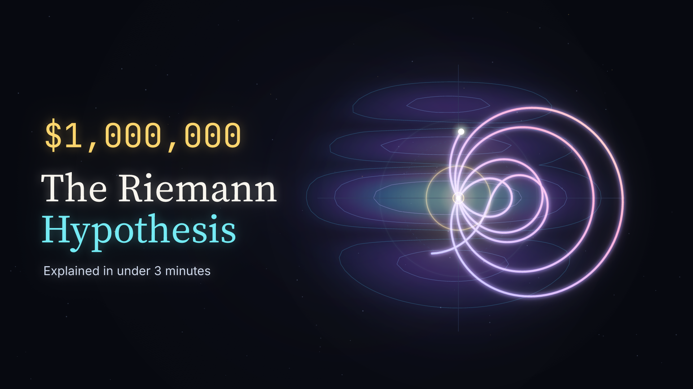

# The Riemann Hypothesis: Music of the Primes



**Goal:** A 2:50 visual journey through the million-dollar prime mystery: Ulam prime galaxy, orbiting 3D zeta landscape, conformal warping, critical-line shockwave spiral, and harmonic prime synthesis.

- **Watch online:** https://bvolpato.github.io/vizmatic-public-videos/riemann-hypothesis/
- **Category:** Mathematics
- **Format:** 1920x1080 @ 30 fps (~2:49)

## Scenes

1. **A million-dollar mystery on one line** (`scenes/hook.ts`)
2. **The scattered atoms of arithmetic** (`scenes/primes.ts`)
3. **A golden bridge to a complex landscape** (`scenes/landscape.ts`)
4. **The critical line and its zeros** (`scenes/spiral.ts`)
5. **How the zeros play the music of the primes** (`scenes/music.ts`)
6. **Why every proof claim stops the world** (`scenes/stakes.ts`)

## Build & Check

```sh
uv run factory/build.py riemann-hypothesis --check-only
uv run factory/build.py riemann-hypothesis
```
