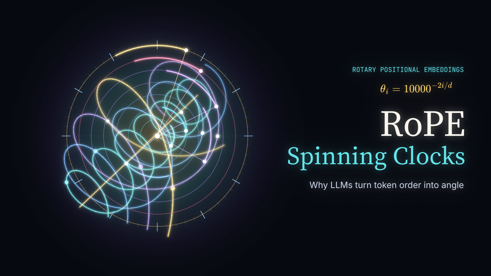

# RoPE: Why LLMs Spin Clocks to Remember Long Context



**Goal:** A cinematic visual journey through Rotary Positional Embeddings: concentric harmonic clock dials, exact complex relative-distance geometry, orbiting 3D helical waves and attention-decay surfaces, and NTK/YaRN frequency scaling to 128k+ tokens.

- **Watch online:** https://bvolpato.github.io/vizmatic-public-videos/rope-long-context/
- **Category:** AI & ML
- **Format:** 1920x1080 @ 30 fps (~2:28)

## Scenes

1. **A galaxy of clocks inside every token** (`scenes/hook.ts`)
2. **Exact 2D complex rotation geometry** (`scenes/clocks.ts`)
3. **3D helical ribbons and attention decay** (`scenes/helix3d.ts`)
4. **Phase collisions and NTK / YaRN scaling** (`scenes/longcontext.ts`)
5. **Position is an angle you spin** (`scenes/finale.ts`)

## Build & Check

```sh
uv run factory/build.py rope-long-context --check-only
uv run factory/build.py rope-long-context
```
