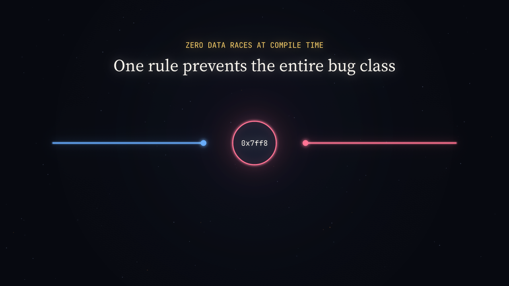

# Rust Concurrency: Ownership Across Time



**Goal:** How Rust eliminates data races at compile time, and how Send, Sync, thread::scope, bounded channels, 48-byte Futures, Tokio work stealing, and drop cancellation fit together. Includes a runnable Rust 2024 + Tokio Cargo lab.

- **Watch online:** https://bvolpato.github.io/vizmatic-public-videos/rust-concurrency/
- **Category:** Systems
- **Format:** 1920x1080 @ 30 fps (~3:14)
- **Companion Rust lab:** [lab/README.md](lab/README.md)

## Scenes

1. **Fearless concurrency before the binary exists** (`scenes/hook.ts`)
2. **Send, Sync, and locks that own their data** (`scenes/ownership.ts`)
3. **Scoped threads, atomics, and bounded channels** (`scenes/scopes.ts`)
4. **Zero-cost async: 48-byte state machines** (`scenes/futures.ts`)
5. **Inside Tokio: work stealing, blocking, and cancellation** (`scenes/tokio.ts`)
6. **Ownership is Rust's concurrency model** (`scenes/finale.ts`)

## Build & Check

```sh
uv run factory/build.py rust-concurrency --check-only
uv run factory/build.py rust-concurrency
```
