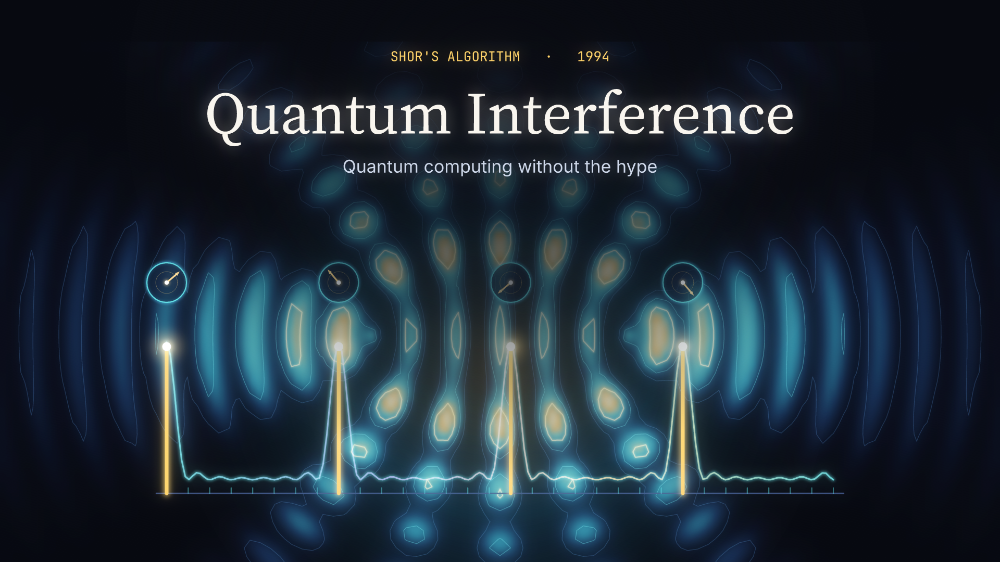

# Quantum Computing Without the Hype: Shor's Algorithm & Interference



**Goal:** A 2:20 visual demystification of quantum computing: complex phase cancellation, an orbiting 3D Bloch sphere, modular period finding for N = 15, and exact Quantum Fourier Transform interference.

- **Watch online:** https://bvolpato.github.io/vizmatic-public-videos/shors-algorithm/
- **Category:** Physics & Quantum
- **Format:** 1920x1080 @ 30 fps (~2:27)

## Scenes

1. **Wave interference, not parallel guessing** (`scenes/hook.ts`)
2. **Amplitudes and phase on the Bloch sphere** (`scenes/bloch3d.ts`)
3. **Factoring fifteen through hidden period** (`scenes/period.ts`)
4. **The Quantum Fourier Transform interference comb** (`scenes/qft.ts`)
5. **Cancel the wrong answers** (`scenes/finale.ts`)

## Build & Check

```sh
uv run factory/build.py shors-algorithm --check-only
uv run factory/build.py shors-algorithm
```
