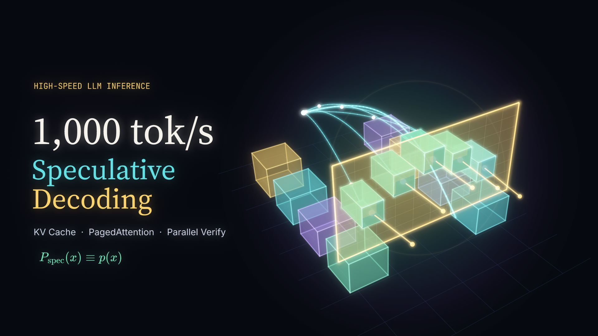

# KV Cache & Speculative Decoding: How LLMs Hit 1,000 Tokens/sec



**Goal:** A cinematic visual breakdown of modern LLM inference: why decoding hits the GPU HBM bandwidth wall, orbiting 3D PagedAttention virtual-to-physical memory blocks, and exact mathematical rejection sampling in speculative decoding.

- **Watch online:** https://bvolpato.github.io/vizmatic-public-videos/speculative-decoding/
- **Category:** AI & ML
- **Format:** 1920x1080 @ 30 fps (~2:17)

## Scenes

1. **Draft cheap, verify in one parallel flash** (`scenes/hook.ts`)
2. **The KV cache and the HBM memory wall** (`scenes/kvcache.ts`)
3. **PagedAttention 3D virtual-to-physical memory blocks** (`scenes/paged.ts`)
4. **Exact mathematical rejection sampling** (`scenes/speculative.ts`)
5. **Four-times throughput, zero quality loss** (`scenes/finale.ts`)

## Build & Check

```sh
uv run factory/build.py speculative-decoding --check-only
uv run factory/build.py speculative-decoding
```
