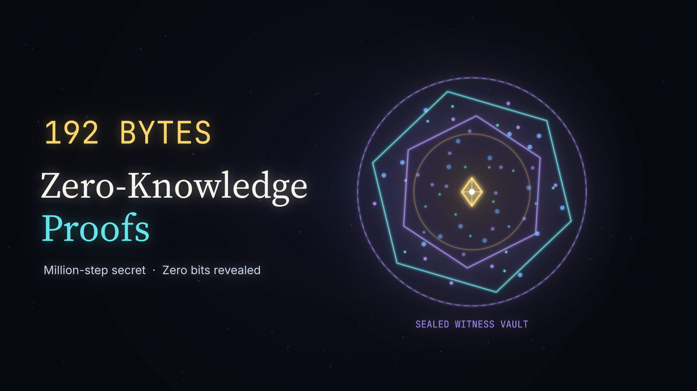

# Zero-Knowledge Proofs: Proving a Secret Without Showing a Bit



**Goal:** A cinematic visual journey inside zk-SNARKs: sealed vaults compressed to 192-byte golden proofs, R1CS arithmetization, orbiting 3D Schwartz-Zippel polynomial surfaces, and homomorphic elliptic-curve blinding.

- **Watch online:** https://bvolpato.github.io/vizmatic-public-videos/zk-snarks/
- **Category:** Cryptography
- **Format:** 1920x1080 @ 30 fps (~2:15)

## Scenes

1. **A 192-byte gem of certainty** (`scenes/hook.ts`)
2. **Arithmetization into polynomials** (`scenes/circuit.ts`)
3. **The Schwartz-Zippel Lemma in 3D** (`scenes/poly3d.ts`)
4. **Homomorphic elliptic-curve blinding** (`scenes/commitment.ts`)
5. **One unforgeable point** (`scenes/finale.ts`)

## Build & Check

```sh
uv run factory/build.py zk-snarks --check-only
uv run factory/build.py zk-snarks
```
